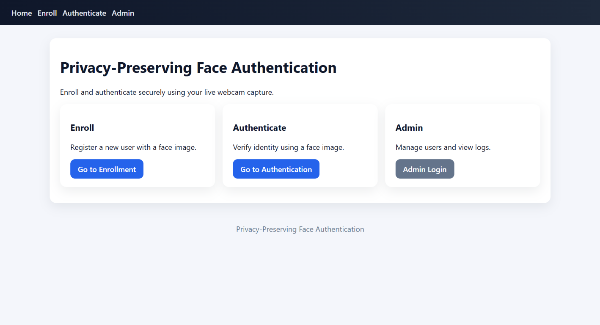
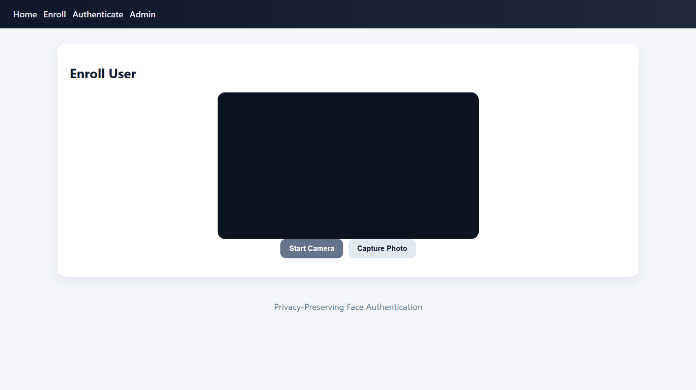
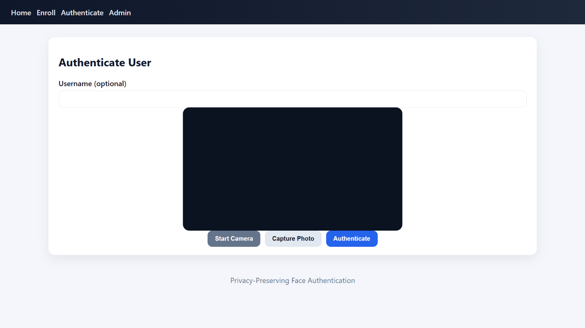
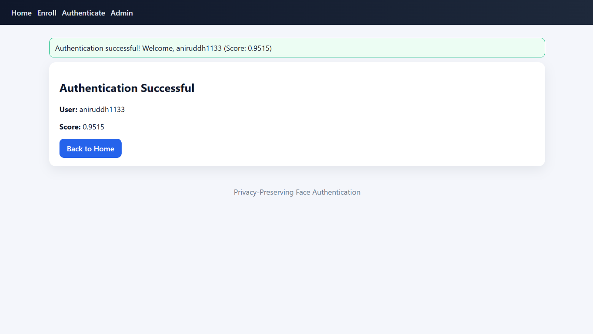

# Privacy-Preserving Face Authentication

<div align="center">

### A local Flask demo for face enrollment and authentication

Capture a face with your webcam, enroll a user, and authenticate against saved face templates. The result page displays the matching username and similarity score.

[Run locally](./Privacy-Preserving-Face-Authentication-Using-Homomorphic-Encryption-main/RUN_LOCAL.md) · [Windows launcher](./Privacy-Preserving-Face-Authentication-Using-Homomorphic-Encryption-main/run_local.bat) · [Application source](./Privacy-Preserving-Face-Authentication-Using-Homomorphic-Encryption-main/abbbb/abbbb/PrivacyPreserving_FaceAuth_HE/)

</div>

> **Research/demo project:** Read the [security and implementation notes](#security-and-implementation-notes) before using this with real biometric data. The current face-matching path does **not** perform comparisons homomorphically.

## Contents

- [Features](#features)
- [Run on Windows](#run-on-windows)
- [Application walkthrough](#application-walkthrough)
- [Understanding the score](#understanding-the-score)
- [Project structure](#project-structure)
- [Security and implementation notes](#security-and-implementation-notes)
- [Troubleshooting](#troubleshooting)

## Features

- Flask web interface with home, enrollment, authentication, and admin pages.
- Webcam capture in the browser; `localhost` allows camera access without HTTPS.
- Face detection and 512-dimensional FaceNet512 embeddings via DeepFace.
- SQLite storage for users, encrypted face-template blobs, and authentication logs.
- Authentication result page showing the recognized username and similarity score.
- TenSEAL CKKS context initialization is included as an experimental part of the project.

## Run on Windows

### Quick start

1. Install **64-bit Python 3.12**.
2. Open the [`Privacy-Preserving-Face-Authentication-Using-Homomorphic-Encryption-main`](./Privacy-Preserving-Face-Authentication-Using-Homomorphic-Encryption-main/) folder and double-click [`run_local.bat`](./Privacy-Preserving-Face-Authentication-Using-Homomorphic-Encryption-main/run_local.bat).
3. On first run, the launcher creates an isolated environment under `%LOCALAPPDATA%\PrivacyPreservingFaceAuth`, installs the requirements, and starts the server. Keep its window open.
4. Open **[http://127.0.0.1:5000](http://127.0.0.1:5000)** and allow camera access when prompted.
5. Stop the server by pressing **Ctrl+C** in the launcher window.

The first dependency install downloads TensorFlow and computer-vision packages and may take several minutes. Face-recognition models may also download the first time they are needed.

For manual setup and recovery instructions, see [`RUN_LOCAL.md`](./Privacy-Preserving-Face-Authentication-Using-Homomorphic-Encryption-main/RUN_LOCAL.md).

### First-time admin login

- **Username:** `admin`
- **Password:** `admin123`

These are demo defaults for a newly created database. Do not expose the app publicly or reuse these credentials for a real service.

## Application walkthrough

The screenshots below are shown in order: home page, enrollment, authentication, then the successful result with its score.

### 1. Home page

Choose **Enroll**, **Authenticate**, or **Admin** from the home page.



### 2. Enroll a user

Start the camera, capture a clear face image, then enter a unique username and optional name/email when prompted.



### 3. Authenticate

Start the camera and capture a face. Username is optional; when omitted, the app searches active users.



### 4. Authentication result and score

On a successful match, the result page displays the recognized user and the similarity score. In the example below, the score is **0.9515**.



## Understanding the score

The app compares the face embeddings using cosine similarity and displays the result on a **0 to 1** scale, rounded to four decimal places. The configured authentication threshold is **0.85** (`AUTHENTICATION_THRESHOLD` in [`src/config.py`](./Privacy-Preserving-Face-Authentication-Using-Homomorphic-Encryption-main/abbbb/abbbb/PrivacyPreserving_FaceAuth_HE/src/config.py)).

The **0.9515** shown above is the result from that screenshot's run. Scores can vary with camera, lighting, pose, and image quality. A similarity score is **not** a probability or a guarantee of identity.

## Project structure

```text
.
├── README.md
├── docs/
│   └── screenshots/
│       ├── 01-home.png
│       ├── 02-enrollment.png
│       ├── 03-authentication.png
│       └── 04-authentication-score.png
└── Privacy-Preserving-Face-Authentication-Using-Homomorphic-Encryption-main/
    ├── RUN_LOCAL.md
    ├── run_local.bat
    └── abbbb/abbbb/PrivacyPreserving_FaceAuth_HE/
        ├── app.py
        ├── requirements.txt
        ├── src/
        └── templates/
```

Key application files:

- [`app.py`](./Privacy-Preserving-Face-Authentication-Using-Homomorphic-Encryption-main/abbbb/abbbb/PrivacyPreserving_FaceAuth_HE/app.py) — Flask routes and application startup.
- [`requirements.txt`](./Privacy-Preserving-Face-Authentication-Using-Homomorphic-Encryption-main/abbbb/abbbb/PrivacyPreserving_FaceAuth_HE/requirements.txt) — Python dependencies.
- [`src/face_detection/detect_face.py`](./Privacy-Preserving-Face-Authentication-Using-Homomorphic-Encryption-main/abbbb/abbbb/PrivacyPreserving_FaceAuth_HE/src/face_detection/detect_face.py) — face detection, embeddings, and similarity calculation.
- [`src/database/db_manager.py`](./Privacy-Preserving-Face-Authentication-Using-Homomorphic-Encryption-main/abbbb/abbbb/PrivacyPreserving_FaceAuth_HE/src/database/db_manager.py) — SQLite database operations.
- [`templates/`](./Privacy-Preserving-Face-Authentication-Using-Homomorphic-Encryption-main/abbbb/abbbb/PrivacyPreserving_FaceAuth_HE/templates/) — web pages.

The database and encryption key are created locally when the application runs. Keep backups of both if you need to preserve enrolled accounts.

## Security and implementation notes

- The project initializes a TenSEAL CKKS context, but its current `encrypt_embedding` function calls `context.encrypt`, which is not a TenSEAL `Context` API. It catches the resulting error and falls back to a plain NumPy embedding.
- As a result, the current matching path compares embeddings in application memory; it is **not homomorphic encrypted matching**. Stored templates are Fernet-encrypted at rest, but that does not make the matching computation encrypted.
- Treat this repository as an educational prototype, not a production authentication or privacy solution. Do not use real or sensitive biometric data until the encryption and authentication design has been reviewed and corrected.
- The default admin credentials and Flask secret key are for local demonstration only. Do not expose the development server to the internet.

## Troubleshooting

| Problem | What to check |
|---|---|
| Launcher says Python 3.12 is missing | Install 64-bit Python 3.12, then rerun `run_local.bat`. |
| Dependencies fail to install | Check your internet connection and keep the full error from the launcher window. |
| Browser cannot use the camera | Open the app at `http://127.0.0.1:5000` and allow camera permission in the browser. |
| No face is detected | Use a clear, front-facing image with good lighting. |
| Port 5000 is already in use | Stop the other local Flask process, then run the launcher again. |
